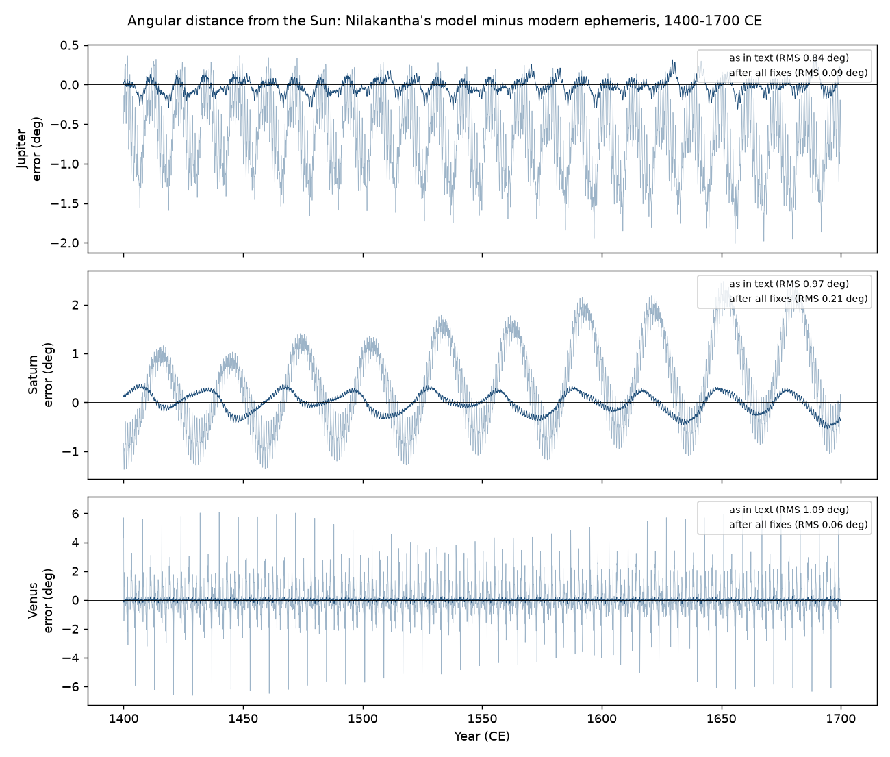
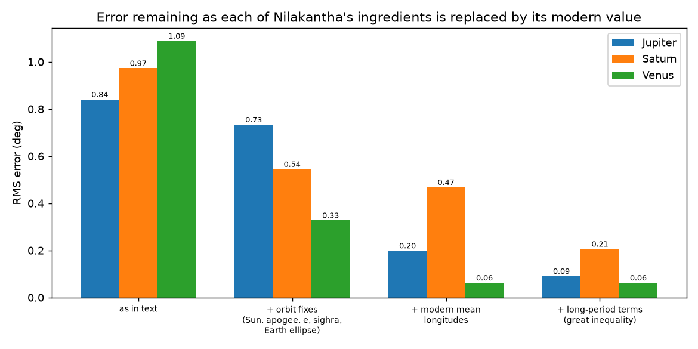

# How accurate was Nīlakaṇṭha's planetary model, and why?

**A quantitative error analysis of the planetary model in *Tantrasaṅgraha* (Nīlakaṇṭha Somayājī, Kerala, c. 1500 CE) against a modern ephemeris, 1400–1700 CE.**

> 🚧 Research in progress, not peer reviewed. Mars and Mercury are not yet included (see *Limitations*).



## Summary

Around 1500 CE, Nīlakaṇṭha Somayājī gave a complete computational scheme for planetary positions in *Tantrasaṅgraha*. Historians have shown that his revised model is close to Kepler's in structure. This project asks a quantitative question: **how large are its errors over three centuries, and which of its assumptions cause which part of the error?**

The model for Jupiter, Saturn and Venus is reimplemented using only parameters from the text, compared with a modern ephemeris every 5 days from 1400 to 1700 CE, and its error is decomposed by:

1. **Spectral analysis**: which physical cycles the error follows;
2. **Ablation**: replacing one ingredient at a time with its modern value and measuring which error component disappears;
3. **Sparse regression**: testing whether a data-driven method recovers the same structure without physical hypotheses.

## Main results

| | Jupiter | Saturn | Venus |
|---|---|---|---|
| RMS error, model as in the text | 0.84° | 0.97° | 1.09° |
| After replacing every ingredient with its modern value | 0.09° | 0.21° | 0.06° |



*(Venus has no long-period correction term, so its last two bars are identical.)*

### Attribution of the main error components

| Error component | Cause | Evidence |
|---|---|---|
| 1-year cycle (Jupiter, Saturn) | The Sun's equation of centre: ratio 3/80 vs modern 2e = 0.034 | 85–98% removed by the modern value |
| Jupiter's 11.86-yr cycle | Earth's orbit treated as a uniform circle around the mean Sun (mean Sun as *śīghrocca*, constant Earth–Sun distance) | 58% removed |
| Saturn's 29.5-yr cycle | Saturn's apogee: 240° in the text vs 247.6° (modern, in the text's frame) | 58% removed; 88% with modern eccentricity |
| Jupiter's orbit/3 cycle | The variable manda radius (7 + \|sin\|)/82 | 95% removed by a constant radius; absent for Saturn, whose radius is constant in the text, as predicted |
| Synodic cycles (Jupiter, Saturn) | The variable *śīghra* radius | 36% (Jupiter), 79% (Saturn) removed |
| Constant bias and drift (Jupiter, Saturn) | Epoch positions and mean motions. Saturn's drift needs the Jupiter–Saturn *great inequality*, which no Keplerian or epicyclic model contains | Removed by JPL mean longitudes with their long-period terms |
| Synodic cycles (Venus) | Venus's mean longitude relative to the Sun (≈ −0.44°), magnified near inferior conjunction | RMS 0.33° → 0.06° |

### Two structural findings

- **The four-step process implicitly accounts for the planet's distance from the Sun.** For both Jupiter and Saturn, the four-step procedure gives almost the same result as a two-step procedure with the planet–Sun distance included explicitly. Adding the distance on top of the four-step procedure counts it twice and makes the error worse.
- **Venus's parameters are coupled to the Sun's.** Fixing either Earth's orbit or Venus's orbit alone makes Venus *worse* (RMS up to 2.53°); fixing both halves it. The text's Venus manda ratio (average 0.053, apogee 80°) mostly encodes Earth's eccentricity (Sun: 3/80 = 0.0375, apogee 78°) rather than Venus's own (2e = 0.014). This is consistent with the long-known behaviour of interior-planet models since Ptolemy and Āryabhaṭa; the contribution here is the quantitative demonstration for Nīlakaṇṭha's revised model.

### Sparse regression (data-driven check)

Given only the original errors and the model's own angles, sparse (Lasso) regression recovers the main ablation findings for Jupiter and Saturn. For example, it finds the Sun-eccentricity term at 0.205° (ablation: 0.209°) and the orbit/3 term at 0.123° (ablation: 0.123°). For Venus, a plain Fourier library explains much less; terms scaled by the Earth–Venus distance help, showing that interior-planet errors need physics-informed features.

## Method

- **Model:** Nīlakaṇṭha's procedure exactly as in the text: revolution numbers and civil days, epoch positions at the start of the Kali era, apogees, variable manda and *śīghra* epicycles, the four-step process for exterior planets, and the two-step process with Mādhava's iterated hypotenuse for Venus (`model.py`, `exterior.py`, `venus.py`).
- **Epoch:** mean sunrise at Laṅkā, 18 February 3102 BCE (Julian), converted to a Julian day.
- **Modern reference:** astropy's built-in ephemeris (`compare.py`). Errors are computed for the planet's **angular distance from the Sun**, so the zero point of the sidereal zodiac cancels.
- **Modern parameters for ablations:** JPL Keplerian elements (Standish & Williams, Table 2a, valid 3000 BC – 3000 AD), evaluated at 1500 CE (`modern_elements.py`). The constant offset between the J2000 frame and the text's frame (22.56°) is measured from the Sun (`saturn_apogee.py`).
- **Error decomposition:** least-squares fit of sinusoids at the physical periods; sparse regression with scikit-learn's `LassoCV`.

**Checks:** the code reproduces the text's sidereal periods (Appendix F, Table F.1). The drift between the text's Sun and the modern Sun (1.62°/century) matches the value expected from precession plus the text's slightly long year (1.63°/century).

## Reproduce

```bash
pip install -r requirements.txt
python compare.py           # Jupiter error series (creates the data file used by later scripts)
python plot_jupiter.py      # error time series and spectrum for Jupiter
python saturn_apogee.py     # frame offset and the Saturn apogee test
python run_exterior.py      # ablation study for Jupiter and Saturn
python venus.py             # ablation study for Venus
python sparse_residual.py   # sparse regression on the final residuals
python sparse_baseline.py   # sparse regression on the original errors
python make_figures.py      # figures in this README
```

## Limitations

- **Mars and Mercury are not included yet.** Their epoch positions are ambiguous in the available English translation and need checking against the Sanskrit verse.
- **Only longitudes** are analysed; latitudes and orbital inclinations are ignored.
- **The modern variants use first-order formulas.** Residuals of about 0.1° after all fixes are within the precision of this comparison model.
- **Sparse regression** selects many small terms after the physical fixes; it confirms the ablation findings rather than revealing new effects.
- **Novelty:** earlier work includes the translation and analytic comparison with Kepler (Ramasubramanian, Srinivas & Sriram), spot comparisons of computed longitudes, and statistical tests of Nīlakaṇṭha's *eclipse* predictions (Mumford; Shah). To my knowledge, a multi-century error decomposition of the planetary model has not been published.

## Sources

- K. V. Sarma & V. S. Narasimhan, *Tantrasaṅgraha of Nīlakaṇṭha Somayājī*, Supplement to the *Indian Journal of History of Science* 33 (1998), INSA: parameters and verses.
- K. Ramasubramanian, M. D. Srinivas & M. S. Sriram, "The traditional Indian planetary model and its revision by Nīlakaṇṭha Somayājī", Appendix F in K. Ramasubramanian & M. S. Sriram, *Tantrasaṅgraha of Nīlakaṇṭha Somayājī*, Springer / Hindustan Book Agency (2011): equations and parameter tables.
- E. M. Standish & J. G. Williams, *Keplerian Elements for Approximate Positions of the Major Planets*, JPL Solar System Dynamics: modern orbital elements.
- Astropy Collaboration, *astropy*: modern planetary positions.

## Author

Fathima Fiya K M
